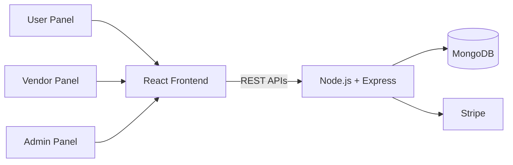

# DomCantoRoyal – Multi-Role Service Marketplace

> A production service marketplace connecting vendors and customers, with separate Vendor, User and Admin panels.

🔗 **Live site:** [domcantoroyal.com](https://domcantoroyal.com)

> **Note:** This is a showcase repository. The source code is proprietary and was developed during my employment at Deftsoft Informatics, so it is not published here. This page describes the project and my contribution.

---

## Overview

DomCantoRoyal lets customers discover and book services, vendors manage their offerings and availability, and admins oversee the platform. Each of the three roles has its own dashboard, permissions and workflows.

## Key Features

- **Three independent role panels:** Vendor, User and Admin, each with its own dashboard, permissions and workflows
- **Real-time service booking** with availability management and status tracking
- **Secure payments** through Stripe, with checkout and transaction history
- **Role-based access control** across the application
- **Fully responsive UI** built with Tailwind CSS
- **Centralized state management** with Redux

## Tech Stack

| Layer | Technologies |
|---|---|
| Frontend | React.js, Redux, Tailwind CSS |
| Backend | Node.js, Express.js, REST APIs |
| Database | MongoDB |
| Payments | Stripe |
| Version Control | Git, GitHub |

## High-Level Architecture

## My Contribution

- Built the Vendor, User and Admin panels, including dashboards and permission handling
- Developed the real-time booking flow with availability management and status tracking
- Integrated Stripe for secure checkout and transaction history
- Managed application state with Redux and built the responsive UI with Tailwind CSS

<!-- Edit this list so it matches exactly what YOU built. -->

## What I Learned

- Designing multi-role applications with separate permissions and workflows
- Handling payment flows securely with Stripe
- Managing complex application state in a large React app

## Contact

**Deepak Kumar** · MERN Stack Developer
[LinkedIn](https://www.linkedin.com/in/deepak-kumar-1479102b2/) · [GitHub](https://github.com/Dhaniadeepak) · meritdeepak2004@gmail.com
